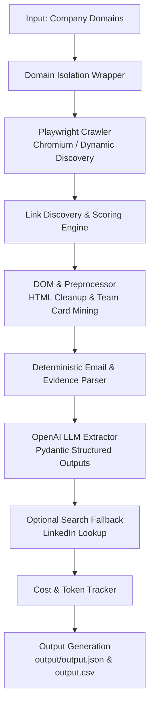

# 🚀 Autonomous Lead Enrichment Agent

An autonomous Python agent that takes company domains as input, crawls and parses their public web presence using headless browser automation (Playwright), cleans and optimizes content, and outputs structured company intelligence using OpenAI structured outputs with strict Pydantic schemas.


## 🏛️ System Architecture



### Pipeline Overview

| Step | Module | Description |
|:-----|:-------|:------------|
| **1. Crawl & Discovery** | `crawler.py` | Playwright Chromium renders pages, handles JS dynamic loads (`domcontentloaded`), and ranks links using URL/path relevance, anchor text, and DOM context. Max 5–8 pages per domain. |
| **2. Preprocessing** | `preprocessor.py` | Removes scripts, styles, SVGs, iframes, navigation boilerplate, and cookie banners. Extracts team cards and mailto: links deterministically. Optimizes tokens by ~90–95%. |
| **3. Evidence Parser** | `preprocessor.py` | Categorizes content into target leadership evidence vs. third-party mentions (customer logos, testimonials, partner quotes). |
| **4. Structured LLM** | `extractor.py` | Interfaces with OpenAI (`gpt-4o-mini`) enforcing Pydantic schemas (`CompanyIntel`, `TeamMember`, `ContactPoint`) via Instructor. |
| **5. Enrichment** | `search_fallback.py` | Optional LinkedIn search fallback when direct URLs are absent. Tracks `linkedin_source` (`website` / `search` / `null`). |
| **6. Aggregation** | `main.py` | Wraps domain execution in isolated try/except handlers and outputs `output/output.json` & `output/output.csv`. |

---

## 🎯 Key Features & Design Choices

### 1. Automated Browsing & Content Retrieval
- **Playwright Chromium**: Uses Playwright for browser automation, supporting modern React, Next.js, and JavaScript-heavy websites.
- **Smart Wait Strategy**: Avoids hanging on `networkidle` by combining `domcontentloaded`, targeted rendering waits, and 30-second timeouts.
- **Intelligent Link Scoring**: Ranks candidate subpages using path relevance, anchor text, and DOM parent context to discover `/about`, `/team`, `/leadership`, `/company`, `/careers`, `/press`, and `/pricing`.
- **Crawl Limits & Deduplication**: Enforces strict same-domain boundaries, maximum crawl depth (~2), 5–8 page limit per domain, and visited URL tracking.

### 2. Content Preprocessing & Token Optimization
- **DOM Cleanup**: Removes `<script>`, `<style>`, `<svg>`, `<iframe>`, navigation headers, cookie consent modals, and repeated footers.
- **Token Optimization**: Truncates and cleans content down from 200,000+ raw HTML tokens to 5,000–10,000 clean markdown tokens.
- **Deterministic Evidence Extraction**: Pre-extracts candidate emails (`mailto:` and regex) and structured team cards directly from DOM nodes prior to LLM processing.

### 3. Leadership Accuracy & Precision Rules
- **Evidence-Based Inclusion**: The LLM is explicitly instructed NEVER to infer employment from a person's presence on a website.
- **Exclusion of Non-Employees**: Customer testimonials, partner logos, investor quotes, and community speakers are strictly excluded.
- **Third-Party Company Disambiguation**: Prevents merging person names with third-party companies (e.g. `"Rauch Vercel"` or `"Bach Netlify"`).
- **Deduplication**: Merges candidate names to canonical full names (e.g. converting `"Follow Abhinav"` to `"Abhinav Asthana"`).

### 4. LinkedIn URL Discovery & Search Fallback
- **Direct Website Discovery**: Captures direct `linkedin.com/in/...` URLs from page links and team card containers. Never fabricates URLs from names.
- **Optional Search Fallback**: If `SEARCH_API_KEY` (or `TAVILY_API_KEY`) is configured, performs external verification lookup for team members lacking direct URLs. Tracks `linkedin_source` (`"website"`, `"search"`, or `null`).

### 5. Structured Outputs & Scoring
- **Strict Pydantic Schemas**: Enforces output structures using Instructor + OpenAI.
- **Holistic Confidence Score**: Computes a dynamic score (0.0 to 1.0) based on factual evidence quality, overview completeness, ICP specificity, verified contacts, and crawl success.
- **Source Tracking**: Preserves exact source URLs separately (`source_url`) without polluting role titles.

### 6. Fault Tolerance & Resilience
- **Per-Domain Isolation**: A network error, 404, 403, or rate limit on one page or domain will never crash the pipeline. Failed pages are logged in `crawl_stats.pages_failed` and execution continues smoothly.

---

## 💻 Installation & Setup

### Prerequisites
- Python 3.10+
- OpenAI API Key

### Quick Start

```bash
# 1. Clone the repository
git clone https://github.com/your-repo/lead-enrichment-agent.git
cd lead-enrichment-agent

# 2. Create and activate virtual environment
python -m venv venv
# On Windows:
venv\Scripts\activate
# On Linux/macOS:
source venv/bin/activate

# 3. Install dependencies
pip install -r requirements.txt

# 4. Install Playwright browser binaries
playwright install chromium

# 5. Configure environment variables
cp .env.example .env
# Open .env and add your GEMINI_API_KEY
```

### Environment Variables (`.env`)

```env
GEMINI_API_KEY=your-gemini-api-key-here
GEMINI_MODEL=gemini-3.8-flash    # Optional: auto-fallback to next available model
LLM_CONCURRENCY=1
LLM_REQUEST_DELAY_SECONDS=2.0
TAVILY_API_KEY=                  # Optional: Tavily API key for LinkedIn verification
```

---

## 🏃 Running the Agent

### Command Line Interface (CLI)

```bash
# Default run on assignment test domains (postman.com, supabase.com, vapi.ai)
python main.py

# Custom domains via CLI arguments
python main.py --domains stripe.com github.com vercel.com

# Pass positional domains
python main.py postman.com supabase.com vapi.ai

# Load domains from JSON file
python main.py --file domains.json

# Enable verbose debug logs
python main.py --verbose
```

---

## 🧪 Running Unit Tests

The test suite covers HTML preprocessing, email extraction, link scoring, domain normalization, Pydantic model validation, and candidate deduplication.

```bash
# Run pytest suite
python -m pytest tests/
```

Output:
```
============================= 11 passed in 0.81s ==============================
```

---

## 📊 Sample Output Structure

Execution generates structured results saved in `output/output.json` (and `output.json`):

```json
[
  {
    "domain": "postman.com",
    "status": "success",
    "intelligence": {
      "company_overview": "Postman is an API platform for building, testing, and managing APIs. It simplifies each step of the API lifecycle and streamlines collaboration so you can create better APIs—faster.",
      "target_audience": "Software engineers, API developers, DevOps teams, and tech organizations building or integrating APIs.",
      "contact_points": [
        {"email": "help@postman.com", "context": "Support email"}
      ],
      "key_leadership": [
        {
          "name": "Abhinav Asthana",
          "role": "CEO & Co-Founder",
          "linkedin_url": "https://www.linkedin.com/in/abhinavasthana",
          "source_url": "https://postman.com/about",
          "linkedin_source": "website"
        }
      ],
      "data_confidence_score": 0.85
    },
    "pages_crawled": 9,
    "crawl_stats": {
      "pages_crawled": 9,
      "pages_failed": 0,
      "candidate_links_found": 209,
      "relevant_links_selected": 9
    },
    "cost_usd": 0.0034,
    "tokens_used": 15420,
    "errors": []
  }
]
```

---

## 📂 Project Directory Structure

```
.
├── main.py               # CLI entry point & per-domain pipeline runner
├── config.py              # Configuration settings and environment variables
├── crawler.py             # Playwright Chromium crawler & dynamic link discovery
├── preprocessor.py        # HTML stripping, DOM card extraction, token budgeting
├── extractor.py           # LLM extraction via Instructor + OpenAI Pydantic schemas
├── search_fallback.py     # LinkedIn search fallback mechanism
├── cost_tracker.py        # Token counting and cost calculation
├── models.py              # Pydantic data schemas
├── utils.py               # Shared helpers (logging, domain normalization, regex)
├── tests/                 # Pytest test suite
│   ├── test_crawler.py
│   ├── test_extractor.py
│   ├── test_models.py
│   └── test_preprocessor.py
├── output/                # Target output folder
│   ├── output.json        # Primary structured output JSON
│   └── output.csv         # Flattened CSV output
├── LOOM_SCRIPT.md         # Video walkthrough script
├── pyproject.toml         # Package metadata and test setup
├── requirements.txt       # Dependencies
├── .env.example           # Environment template
└── README.md              # Project documentation
```

---

## 🔮 Limitations & Future Work

1. **CAPTCHA / Stealth Crawling**: Some enterprise domains employ Cloudflare Turnstile or Akamai Bot Manager. Integrating Playwright-stealth or rotating proxy networks would improve extraction rates on high-security sites.
2. **Multi-Language Support**: Expanding regex heuristics and link scoring dictionaries to support non-English corporate websites.
3. **Graph-Based Leadership Disambiguation**: Cross-referencing Wikidata or Crunchbase APIs for real-time verification of executive board changes.
